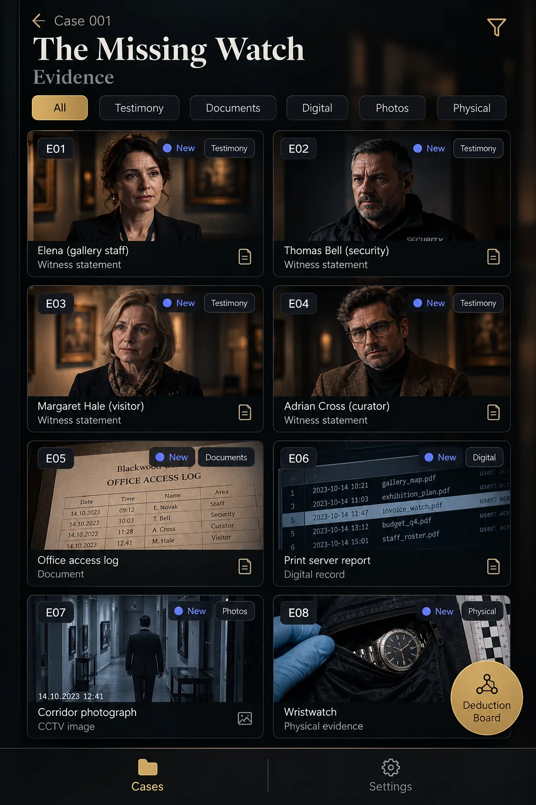
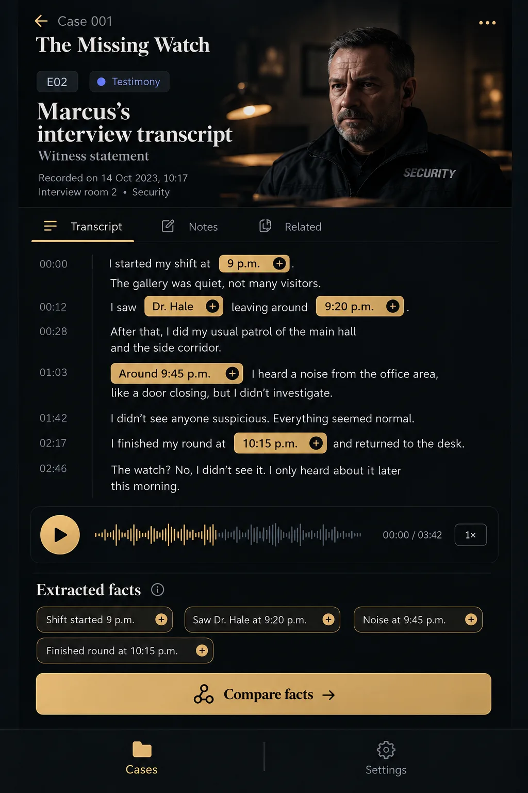
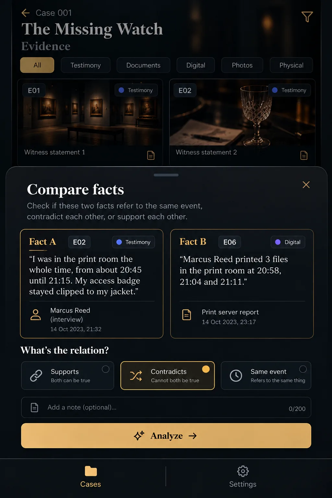
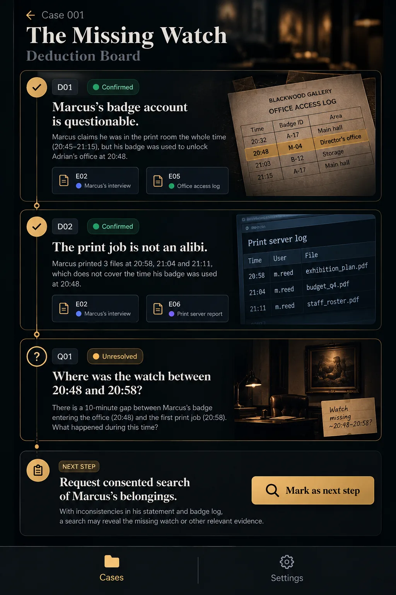
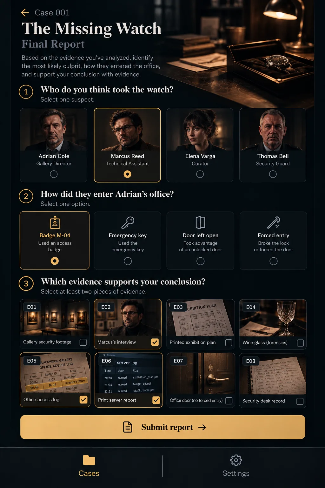

# Accepted UI art — implementation handoff

All five UI mockups were **accepted as visual references only** by the user. They are not canonical evidence documents and must not be used as rasterized interactive screens. Implement the UI natively in Expo / React Native using the case definitions and `docs/ART-PROMPTS.md`.

## Shared visual rules
- Portrait, cinematic contemporary neo-noir; abyss #101318, slate #1B222B, brass #C9A46B, ivory #E8E2D8.
- Clear selection, locked/unlocked and New/Inspected states driven by app state.
- Bottom navigation: **Cases** and **Settings** only.
- Generated mockups can contain hallucinated names, dates, evidence content, timestamps, and portraits. **Canonical case data takes precedence**.
- The generated PNGs were accepted in the ChatGPT conversation but are **not committed here**; binary image transfer was unavailable in this workflow.

## UI-EVIDENCE — `ui-evidence.png` — ACCEPTED

Two-column evidence card grid, category filters **All / Testimony / Documents / Digital / Photos / Physical**, status badges, floating Deduction Board button. Title: Case 001 / The Missing Watch. Canonical evidence:
- E01 Adrian Vale statement
- E02 Marcus Reed statement
- E03 Elena Cross statement
- E04 Thomas Bell statement
- E05 Office access log
- E06 Print server report
- E07 Guest corridor photograph (NOT CCTV)
- E08 Security desk record (NOT recovered wristwatch)
- E09 Watch recovery (Physical) appears in the grid **only after A01 (consented search) is performed**. It arrives as **New** (revealed but not yet inspected) and must never appear before A01. The mockup's “E08 Wristwatch” card is a spoiler error: E08 is the security desk record.

## UI-DETAIL — `ui-detail.png` — ACCEPTED

Evidence detail with portrait or supporting media, transcript, selectable/extractable facts, and **Compare facts** button. E02 is **Marcus Reed**, not Thomas Bell. His canonical testimony includes: “I was in the print room the whole time, from about 20:45 until 21:15. My access badge stayed clipped to my jacket.” Do not copy invented Dr. Hale, patrol/noise stories, or 2023 dates. Extracted fact chips must come from the actual case data.

## UI-COMPARE — `ui-compare.png` — ACCEPTED

Bottom sheet with Fact A / Fact B, **Supports / Contradicts / Same event**, optional note and **Analyze**. Compare Marcus's E02 badge account against **E05: Badge M-04 unlocked Adrian's office at 20:48**. The mockup's example pair should be E02 badge account vs E05 badge M-04 at 20:48 (R01, `contradicts`). Which pairs are valid is decided only by the case data and engine, never hardcoded in the UI. E02 (Marcus's print-room claim) and E06 (print server report) are also a valid authored pair (R02, `supports`) that unlocks D02. Selection is player-controlled, not hardcoded to Contradicts. Badge use does **not** independently establish the badge holder's identity.

## UI-BOARD — `ui-board.png` — ACCEPTED

Vertical connected deduction chain. D01 **“Marcus's badge account is questionable.”** D02 **“The print job is not an alibi.”** One unresolved question and follow-up action **“Request consented search of Marcus's belongings.”** Confirmations and action availability must come from deduction-engine prerequisites. Do not treat generated log screenshot details or suggested 20:48–20:58 question text as canonical.

## UI-REPORT — `ui-report.png` — ACCEPTED

Three-step Final Report: (1) select suspect, (2) choose entry method, (3) select supporting evidence, then **Submit report**. Suspects: **Adrian Vale, Marcus Reed, Elena Cross, Thomas Bell** using their established portraits. Entry methods: **Badge M-04 / Emergency key / Door left open / Forced entry**. Evidence options are the evidence the player has inspected, including E09 once A01 (consented search) has revealed it **and the player has inspected it**. Proof sets may also include deductions (D01–D03). Require one suspect, one entry method and **at least one selected proof item** before submitting; the engine checks accepted proof sets and rejects irrelevant extra proof. For Case 001, the supporting evidence is **E05 + E09**, with deductions D01–D03. The generated image preselects Marcus, Badge M-04 and E02/E05/E06; those selections are illustrative, not defaults. Evaluate via the actual case/deduction engine.

## Implementation notes
- Mockups are about **2.5× denser** than a real phone (1024 px mock ≈ 390 pt wide), so card labels would render near 8 pt. Production body text must be **at least 15 pt**; scroll the six filter pills horizontally and reduce text on grid cards.
- Blue **New** dots and green **Confirmed** chips fall outside the palette. Use brass/ivory with **icon + label**, never colour alone.
- Omit unplanned features: the audio player and **Notes / Related** tabs on Evidence Detail, and the optional note field on Compare. Compare must **not** preselect a relationship.
- The Deduction Board follow-up button **performs** the action (“Request search”); it does not “Mark as next step”.
- Preserve from mockups: two-column evidence grid with ID/status/category badges; fact chips highlighted inline in transcripts; Compare option subtitles **“Both can be true / Cannot both be true / Refers to the same thing”**; vertical deduction chain with source-evidence chips; three-step report with portrait chips and entry-method icons.

## Fair-play constraints
- Guest corridor photo does not positively identify Marcus.
- Print jobs do not establish continuous presence in the print room.
- Badge assignment alone does not prove who used the badge.
- Follow-up search and recovered-watch evidence only appear when their investigation prerequisites are met.
- Keep all text, timestamps and metadata aligned with the canonical Case 001 documents.

## Acceptance and asset availability
Visual concepts: 5/5 accepted. Generated text in the images is not canonical; use case data. Actual generated image PNGs: **not included in this PR**; this handoff is a specification, not an image bundle.

See prior discussion on PR #2 for the UI-EVIDENCE, UI-DETAIL, UI-COMPARE and UI-BOARD review comments.
